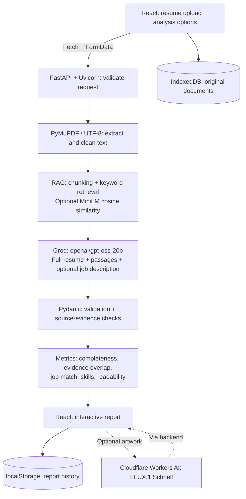

# AlignCV

AlignCV provides evidence-backed resume insights, helping job seekers strengthen their applications and recruiters assess alignment with role requirements.

## Features

- PDF/TXT upload with a 5 MB limit and a built-in sample resume.
- Brief, detailed, or bullet summaries with adjustable analysis depth and focus.
- Name, email, skills, education, and experience extraction with supporting quotations.
- Completeness checks, summary evidence overlap, and improvement recommendations.
- Job-description comparison with essential/preferred requirements and evidence.
- Skills categories, counts, optional AI artwork, and ATS readability checks.
- Browser-based document preview/download, report history, and print-to-PDF.

## Technology stack

| Layer | Technologies | Purpose |
|---|---|---|
| Frontend | React 18, Vite 6, JavaScript/JSX | Interface, state, API requests, and production build |
| Styling | Custom CSS, Lucide React | Responsive layouts and icons |
| Backend | Python, FastAPI, Uvicorn | Upload handling and analysis API |
| Documents | PyMuPDF, Python UTF-8 decoding | PDF and TXT text extraction |
| Validation | Pydantic | Structured AI-response validation |
| Retrieval | Python keyword overlap; optional Sentence Transformers and NumPy | Relevant resume-passage selection |
| Integrations | Groq SDK, HTTPX, python-dotenv | AI calls, HTTP requests, and environment loading |
| Storage | localStorage, IndexedDB | Browser report history and original documents |
| Testing / hosting | Python unittest, Render Blueprint | Backend checks and deployment configuration |

Exact dependency declarations are in `frontend/package.json`, `backend/requirements.txt`, and `backend/requirements-rag.txt`.

## AI models and analysis workflow

| Service / model | Usage |
|---|---|
| Groq API / `openai/gpt-oss-20b` | Default model for structured resume analysis; configurable through `GROQ_MODEL` |
| `sentence-transformers/all-MiniLM-L6-v2` | Optional local embedding model for semantic retrieval |
| Cloudflare Workers AI / `@cf/black-forest-labs/flux-1-schnell` | Optional decorative skills artwork |



- **RAG is enabled by default:** passages target 850 characters with 120-character overlap; up to five relevant passages are selected from at most 100 chunks.
- **Default retrieval:** keyword overlap. Optional MiniLM uses normalized embeddings and cosine similarity, with keyword fallback.
- **Model input:** the full resume plus retrieved passages, settings, and optional job description. Disabling RAG skips retrieval while retaining the full resume.
- **Evidence checks:** quotations are checked against normalized source text; populated fields without verifiable evidence are cleared and marked uncertain.
- **Artwork:** requested separately; only predefined skill-category names are sent to Cloudflare.

## Setup and execution

**Prerequisites:** Python 3.11 (deployment target), Node.js 20+, npm, and a Groq API key. Commands below use PowerShell from the repository root.

### 1. Start the backend

```powershell
cd backend
py -3.11 -m venv .venv
.\.venv\Scripts\python.exe -m pip install -r requirements.txt
```

Create `backend/.env` using the variable table below. Set `GROQ_API_KEY` to your own credential, then run:

```powershell
.\.venv\Scripts\python.exe -m uvicorn app.main:app --reload --host 127.0.0.1 --port 8000
```

### 2. Start the frontend

In a second terminal, from the repository root:

```powershell
cd frontend
npm ci
Set-Content .env 'VITE_API_URL=http://localhost:8000'
npm run dev
```

Open **http://localhost:5173**. API health: **http://localhost:8000/api/health**. Interactive API documentation: **http://localhost:8000/docs**.

### 3. Optional semantic retrieval

From `backend`, install the additional dependencies:

```powershell
.\.venv\Scripts\python.exe -m pip install -r requirements-rag.txt
```

Set `ENABLE_MINILM=true` in `backend/.env` and restart the backend. The embedding model downloads on first use; PyTorch and model weights require additional memory and disk space.

## Environment variables

Create backend variables in `backend/.env` and frontend variables in `frontend/.env`. Keep secret values out of source control and frontend configuration.

| Variable | Location | Requirement / default |
|---|---|---|
| `GROQ_API_KEY` | Backend | Required for AI analysis; private credential |
| `GROQ_MODEL` | Backend | Optional; `openai/gpt-oss-20b` |
| `FRONTEND_ORIGIN` | Backend | Localhost origins by default; set the exact frontend HTTPS origin in production; comma-separated origins supported |
| `MAX_UPLOAD_MB` | Backend | Optional; `5`; keep consistent with frontend validation |
| `ENABLE_MINILM` | Backend | Optional; `false` for lightweight keyword retrieval |
| `CLOUDFLARE_ACCOUNT_ID` | Backend | Required only for optional artwork |
| `CLOUDFLARE_API_TOKEN` | Backend | Required only for artwork; Workers AI Read permission |
| `VITE_API_URL` | Frontend | API origin; localhost for development, HTTPS for production; no `/api` path or trailing slash |

Changes to `VITE_API_URL` require a frontend rebuild. No real credentials are included in this README.

## Testing

### Automated checks

From `backend`:

```powershell
.\.venv\Scripts\python.exe -m unittest discover -s tests -v
.\.venv\Scripts\python.exe -m pip check
```

The suite contains **38 tests** covering extraction, chunking, retrieval, evidence checks, scoring, JSON recovery, API behavior, and artwork caching/validation. Provider calls are mocked; these tests do not verify live credentials or quotas.

From `frontend`, with `VITE_API_URL` configured:

```powershell
npm run build
```

### Main-feature checklist

| Test | Expected behavior |
|---|---|
| Load sample resume and analyze | Summary, fields, evidence, skills, and recommendations appear |
| Change summary style and depth | Report reflects the selected options |
| Add sample or pasted job description | Requirement comparison includes statuses and source quotations |
| Review extracted details and metrics | Supported, missing, and uncertain fields are distinguishable |
| Open ATS readability | Observable checks and extracted text are available |
| Refresh and reopen history | Saved reports remain in the same browser |
| Preview/download/delete an uploaded resume | IndexedDB document actions work independently of report history |
| Upload empty, corrupt, unsupported, scanned, or oversized files | Clear validation errors appear |
| Request artwork with valid Cloudflare configuration | Decorative image loads without changing skill counts |
| Check `/api/health` and settings | Backend responds and provider status is shown |

## Metrics and reliability

| Metric | Interpretation |
|---|---|
| Completeness | Each of five nonempty, source-verified fields contributes 20%; this measures field coverage |
| Summary evidence | Meaningful-word overlap with verified excerpts; paraphrases may score lower |
| Job match estimate | Essential requirements weigh 3, preferred requirements 1; met earns full credit, partial 40%, missing zero |
| ATS readability | Checks extracted text, supported contact fields, headings, and replacement characters |

Missing essential requirements cap job match at 59%; partial essentials cap it at 79% when no essential is missing. AI assessments and quotation matching can still be incorrect. These review aids are not an employer ATS score or a guarantee of factual accuracy.

## Deployment

Use the root `render.yaml` to create a Render Blueprint from the repository. It defines separate API and static frontend services.

| Setting | Backend | Frontend |
|---|---|---|
| Root directory | `backend` | `frontend` |
| Build | `pip install -r requirements.txt` | `npm ci && npm run build` |
| Start / publish | `uvicorn app.main:app --host 0.0.0.0 --port $PORT` | `dist` |
| Runtime configuration | Python 3.11.11; MiniLM disabled | Node.js 22.21.0 |

1. Set `GROQ_API_KEY`, `FRONTEND_ORIGIN`, and `VITE_API_URL` using the actual assigned service URLs.
2. Add Cloudflare backend variables only if artwork is needed.
3. Redeploy after URL changes; frontend API URL changes require a new build.
4. Verify health, samples, real analysis, CORS, browser storage, and optional artwork on the deployed site.

No database service is required. Keep `.env`, `.venv`, `node_modules`, and `dist` excluded from Git.

## Known limitations and privacy

- PDF/TXT only; OCR for scanned PDFs and DOCX support are not implemented.
- Extracted resume text is limited to 100,000 characters; job descriptions are truncated to 12,000 characters.
- No user authentication, per-user provider quotas, or server-side history synchronization.
- Up to 20 reports are stored in localStorage; original documents are stored separately in IndexedDB. Clearing browser site data removes them.
- The API processes uploads in memory; resume text and supplied job descriptions are sent to Groq for analysis.
- RAG includes the full resume and adds passages, so it does not reduce prompt token usage in this implementation.
- Provider availability, quotas, and network errors can interrupt analysis; MiniLM adds model-download and memory costs.
- Readability checks do not validate visual layout or compatibility with a specific employer parser.
- Protect provider-backed endpoints with authentication and quotas before exposing them to unrestricted public use.

## Screenshots

### Resume upload and job description


### Resume analysis and job comparison


*Scores shown are specific to the illustrated analysis.*
